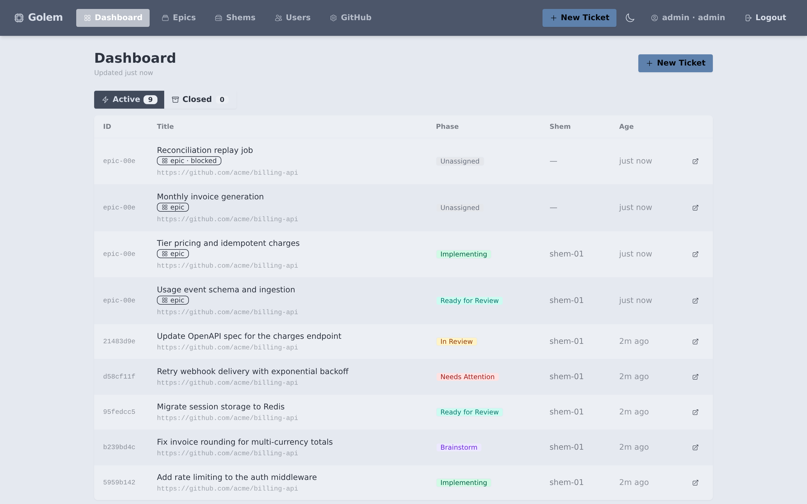
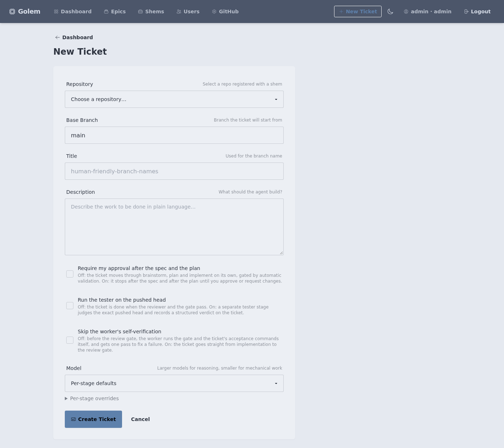
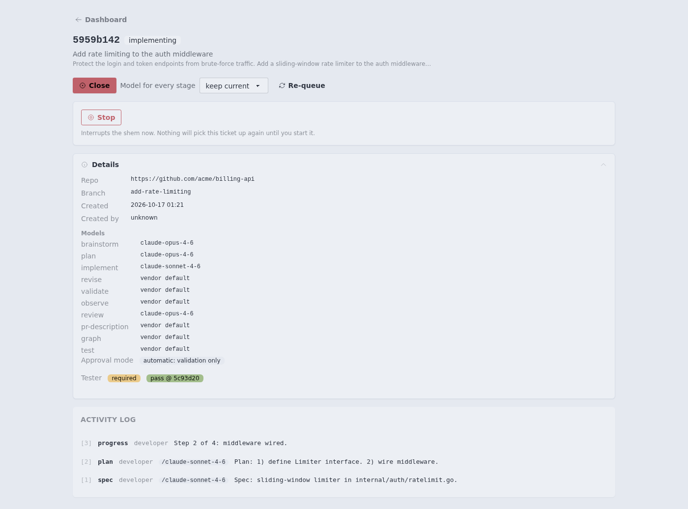
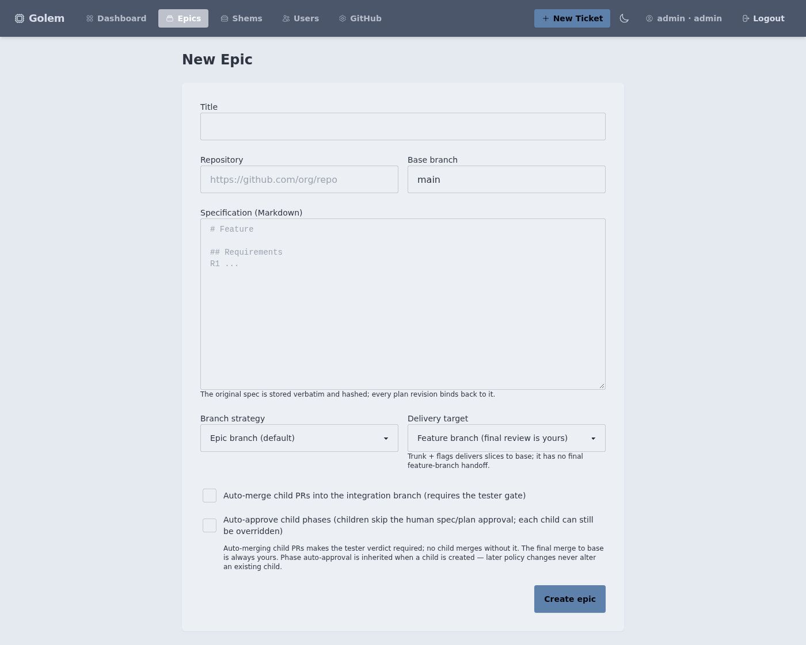
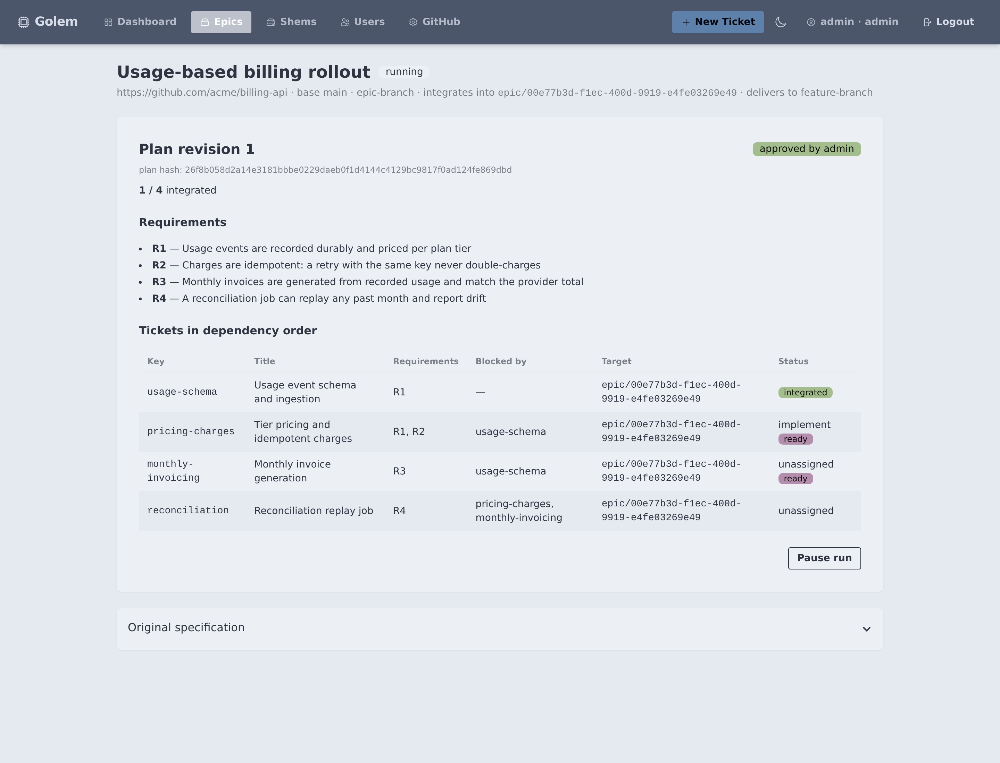
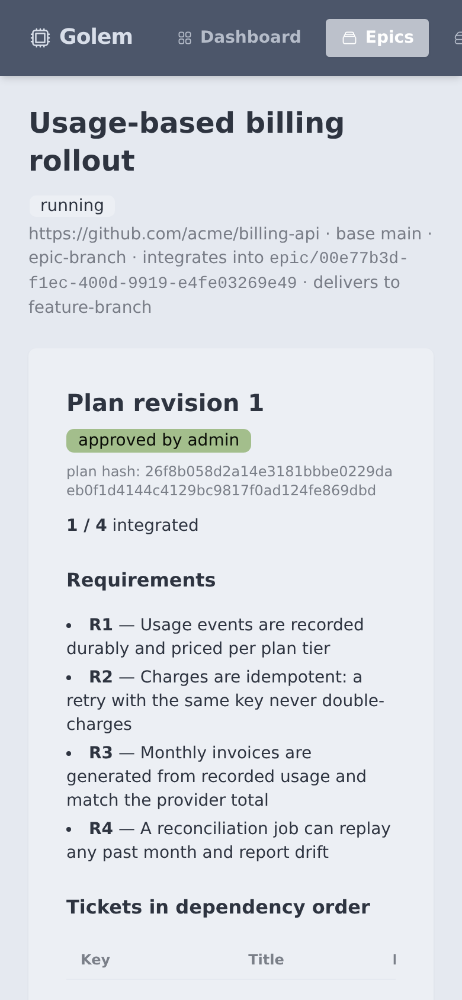
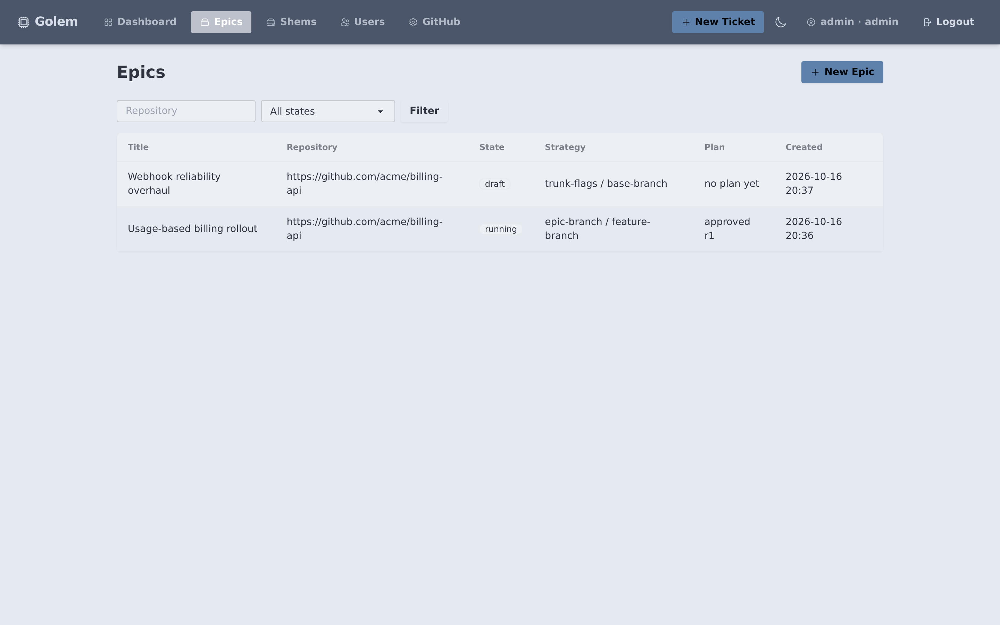

# Tickets and Epics

Golem runs on one primitive: the **ticket**. Every change, from a one-line fix
to a multi-week feature, moves through the same lifecycle with the same gates.
An **epic** composes tickets: it turns one approved specification into a
dependency graph of ordinary tickets and drives them through that same
lifecycle until the whole graph is integrated.

This document covers both: what a ticket is, how it is gated, and how epics
plan, run, and integrate groups of them.

---

## Tickets

### What a ticket is

A ticket is a unit of work with its own git worktree and branch
(`ticket/<id>`), isolated from the base branch and from every other in-flight
ticket. Its state lives in the repo:

```
.golem/tickets/<id>/
  state.json   ← phase, branch, worktree path
  log.jsonl    ← append-only blackboard: every finding, blocker, resolution
```

In distributed mode the same ticket is created in the web UI and executed by a
shem (a worker node); the orchestrator holds the shared state in SQLite or PostgreSQL and
streams the blackboard to the dashboard as the shem works.



### Lifecycle

```
unassigned → claimed → brainstorm → plan → implement → review → ready-for-review → closed
```

Two side states route work back for attention:

- **needs-attention** — a gate command failed, the reviewer's verdict was
  FAIL, or a required verdict is missing. A human (or a shem, after a
  decision) resumes the ticket from here.
- **revising** — a reviewer or tester sent the work back with feedback; the
  shem fixes on the same branch and re-enters review.

### Roles

Each phase runs a distinct role. Roles are markdown prompts owned by the repo
(`.golem/roles/`), so a project tunes its own process; the *contract* (what a
role must conclude) is enforced by Golem, not by the prompt.

| Role | When it runs | What it decides |
|---|---|---|
| `developer` | brainstorm, plan, implement | Writes the spec, the plan, and the code |
| `convention-enforcer` | after the last plan-step commit | Naming, structure, project patterns |
| `spec-adherence` | after the last plan-step commit | Scope creep, plan alignment |
| `reviewer` | at review | Full attestation; ends with `VERDICT: PASS` or `VERDICT: FAIL` |
| `tester` | after a flagged ticket is pushed | Judges the exact pushed head and records a verdict |

### The gate and the reviewer verdict

Review is fail-closed. `golem ticket review` (run by the shem in distributed
mode) executes the repo's `gate.commands` plus any acceptance commands the
ticket carries, records the result for the exact head, and then runs the
reviewer over the log and the branch diff:

- A failing gate command blocks the ticket.
- A reviewer `VERDICT: FAIL` blocks it the same way — a failed review cannot
  reach ready-for-review.
- A ticket that carries acceptance commands (every epic child does) also
  blocks when the reviewer produced no verdict at all.

Workers self-verify before asking for review: `golem ticket verify` runs the
gate locally and exits non-zero on failure, so a shem catches its own
regressions before the reviewer sees them. Self-verification runs on **every**
ticket by default, including tickets created before this behavior existed. A
ticket can opt out at creation with "Skip the worker's self-verification" on
the New Ticket form; an opted-out ticket goes straight from implementation to
the review gate and carries a "skipped at the ticket's request" badge on its
detail page.

### Approval modes

Per ticket, the human chooses how much control to keep:

- **Automatic (default)** — the shem advances through brainstorm and plan on
  its own validation and works to ready-for-review without pausing.
- **Manual** — tick "Require my approval after the spec and the plan" and the
  shem pauses after each of those phases until a human approves or requests
  changes in the UI.



### Decisions (human on the loop)

Agents meet open product and design questions: which of two spec texts wins,
what a vague instruction should mean. Each ticket and epic has an
`ask_decisions` flag for these:

- **Off (default): agents decide** — the developer decides from the guidance,
  records each decision and carries on. The reviewer accepts a deviation from an
  instruction that conflicts with the spec or cannot be built when a recorded
  decision backs it. The failure diagnoser may answer `decide`: it records the
  decision and retries with it as feedback, counting toward
  `attention_fix_attempts` like any retry.
- **On: ask** — open questions go to a human, exactly as before.

Every decision is a `DECISION` entry in the activity log (question, choice,
reason, basis) with its own badge, so a person reviews them by reading the
log. To overturn one, give ordinary feedback (request changes, or retry with
feedback).

Guidance is optional text set alongside it. Empty guidance uses the built-in
default: prefer the option the spec states as its default; where two binding
texts conflict, the later amendment wins; otherwise choose the option that
supports the most use cases without weakening a stated invariant or security
property; keep scope to the ticket.

Where it is set: the "Ask me about open questions" checkbox on the new-ticket
and new-epic forms, or `ask_decisions` and `decision_guidance` in the create
API bodies. There is no repository-level
setting. An epic's flag and guidance are snapshotted into each child when it
is created, so editing the epic later never changes a running child. Tickets
and epics that existed before this feature read as autonomous.

These always go to a human, in every mode: weakening a stated invariant,
security property or gate; editing files the repo marks protected; effects
involving real money or real external providers; contradicting an explicit
owner instruction that is buildable. Brainstorm and plan prompts and the
diagnoser list them. A decision never bypasses a check: it becomes feedback
and an ordinary retry, so every gate, the reviewer and the tester run again on
the result. The implement and revise prompts do not carry the decision block.

### The tester gate

The tester is a per-ticket flag, set at creation with "Run the tester on the
pushed head". When it is on, the shem runs the `tester` role after the
ticket's branch is pushed; the tester judges that exact head against the
ticket's acceptance scenarios and records a structured verdict on the ticket.
Verdicts are append-only and bound to the head SHA — only the newest verdict
*for that exact head* counts. A changed head needs a fresh verdict; it does
not inherit an earlier pass. External pushes do not start a tester run. The detail page shows whether the tester is required and the
latest verdict with the head it judged.

Epics compose the same flag: an epic with auto-merge children sets it on
every child it creates, because the integration lane may only merge a head
the tester passed.

### The activity log

Every role writes to the ticket's blackboard. The orchestrator renders it as a
live activity log — specs, plans, gate results, verdicts, blockers — so a
human can audit not just *what* changed but *why the process allowed it*.



---

## Epics

### What an epic is

An epic turns one specification into several dependent tickets and runs them
as a single workflow. Children are ordinary tickets — same phases, same roles,
same gates — with three additions: they know which epic and node they belong
to, their gate includes the node's acceptance commands, and their merged SHA
is recorded as the receipt that unblocks their successors.

### Creating an epic

An epic is created from a repository, a base branch, and a Markdown
specification. The spec is stored verbatim and hashed; every plan revision
binds back to it. Creation also fixes the run's topology and policy:

- **Branch strategy** — `epic-branch` integrates children into a dedicated
  `epic/<id>` branch; `trunk-flags` integrates them straight into the base
  branch.
- **Delivery target** — `feature-branch` (the run ends in an integrated branch
  a human reviews; the GitHub addon can open its final pull request) or `base-branch` (delivery *is* the base branch;
  required by `trunk-flags`).
- **Auto-merge children** — the shem merges the exact tested child head into
  the integration branch once every gate holds.
- **Auto-approve child phases** — children inherit automatic approval. The
  choice is snapshotted into each child when it is created; editing the epic
  later never changes a child already running.
- **Open questions** — the decision mode (autonomous by default) and optional
  guidance, snapshotted into each child the same way; see "Decisions".

Auto-merge children makes the tester gate mandatory: no child merges without
a tester pass. For `epic-branch` runs, the final merge to base is a human step.



### The plan

The plan is the contract the run executes. It is submitted as JSON with three
parts:

- **Requirements** — the numbered outcomes the spec demands. Every requirement
  must be covered by at least one node, and every node must exist for at
  least one requirement: no uncovered outcome, no orphan work.
- **Nodes** — the proposed tickets, each with a stable key, title, scope,
  non-goals, acceptance commands, and the requirements it serves.
- **Edges** — hard dependencies: the predecessor must be integrated before
  the successor may start.

Plans are validated on submission: well-formed keys, full requirement coverage
in both directions, no cycles, at most 200 nodes. Every save is a new
immutable revision. A human then **approves** a specific revision — the
approval binds the approver's name to the revision *and* its content hash, so
"approved" always means "this exact plan".

### Generating the plan

Writing the plan JSON by hand is one option; the epic page also has a
**Generate plan** button. That queues a durable plan job: a shem with a
checkout of the repo claims it (same lease pattern as tickets, so a dead
shem's job is reclaimed), and runs one planning agent session there — the
session reads the spec, the code graph and the wiki, writes the plan JSON,
and iterates against `golem epic-plan validate --target <ref> <file>`
until the same validator that checks a hand-pasted plan passes. Invalid
output gets one repair session seeded with the validator's errors.

The model comes from the `epic-plan` stage default in `shem.yaml`
(large tier by default — planning shapes every ticket downstream and runs
once per epic).

The finished draft fills the plan box on the epic page. Unless the epic opted
into auto-start (below), nothing becomes a revision until you review, edit if
needed, and click save: approval still binds to the exact content hash, and a
generated plan carries no approval. The orchestrator also re-validates the
posted draft server-side before showing it, so a shem's say-so is never
trusted. Pasting JSON by hand works exactly as before whether or not any plan
job exists.

**Auto-start (opt-in).** An epic created with *auto start generated plan*
(`auto_start_generated_plan`) skips the human step: when a job produces a valid
draft, the orchestrator saves it as a revision, approves that revision and
starts the run, with no human involved. The approval is recorded under the
actor `auto:plan-generation` and still binds the revision's content hash. It is
off by default, so the human gate holds unless the epic opted in. If a step
fails (for example the epic moved on while the job ran), the job keeps the
draft and shows the failure on the epic page.

### The run

Starting an approved epic materializes each node into an ordinary ticket
with its own UUID. From then on the run is just tickets, plus scheduling:

- A child is claimable only while the run is `running` and all of its
  predecessors are integrated. The dashboard shows this directly: children
  carry an epic badge, and blocked children show what they are waiting on.
- Children work through brainstorm → plan → implement → review exactly like
  standalone tickets. Their acceptance commands run in the gate.
- Children of an auto-merge run carry the tester flag, so the shem runs the
  `tester` role against the pushed head and posts its verdict (see *The
  tester gate* above).

**Pause** and **Resume** stop and restart claims and merges at the next
attempt; work already claimed finishes.



The run view reads the same on a phone:



### The integration lane

Integration is how a child's code becomes permanent, and it always ends in a
**receipt**: the merged SHA recorded on the child. A receipt is idempotent —
the same SHA again is a no-op — and a *different* SHA for an already
integrated node is rejected as a conflict. Receipts are what readiness is
computed from, so a successor unblocks exactly when its predecessors' code
has actually merged, never when a ticket merely looks done.

The orchestrator gates each exact tested head and grants one fenced integration
lease per epic. The shem merges through a shared bare Git mirror and pushes
with a lease against the target's previous SHA. The orchestrator then records
the receipt and releases dependents atomically. Child integration does not
require GitHub or child pull requests.

A child stays `ready-for-review` while it waits for its integration receipt.
Once the receipt is recorded, Golem closes that child; the epic itself remains
open for final review until every node has integrated. This keeps a merged
child from looking unfinished while preserving the final manual review of the
combined result.

- Tester **FAIL** returns the child to `revising` with its evidence.
- A merge conflict returns the child to `revising` to resolve against the
  integration branch; the resolved head must pass the tester again.
- Tester **inconclusive** requires attention. Operational Git failures can be
  retried by reconciliation without accepting an unverified receipt.
- A changed head needs a fresh tester verdict. External pushes do not
  automatically trigger a tester run.

Pause blocks new integration leases. Receipts for a merge already in flight
can still be recorded. Local/no-push runs use the same gates and receipts
against local refs.

Manual integration uses the authenticated management API. This is a trusted
human attestation that the code was merged, not an automatic tester-gated
merge; it records the supplied SHA without performing Git verification:

```
POST /api/epics/{id}/nodes/{key}/integrate   {"sha": "<merged-sha>"}
```

### Finishing

When every node is integrated:

- `epic-branch` runs move to `awaiting-final-review` and retain the completed
  `epic/<id>` branch. With the GitHub addon enabled, a final pull request
  to base presents the result. The final merge is a human step: a
  person reviews the whole run as one diff, merges it, and records the final
  base SHA through the UI or API.
- `trunk-flags` runs are already on base, so the last receipt completes the
  run.

Run states: `draft → awaiting-approval → running ⇄ paused →
awaiting-final-review → completed`.



---

## HTTP API

Everything the UI does is available over the API. Epic management endpoints
are session-authenticated; tester verdicts are posted by the shem that holds
the child.

| Endpoint | Purpose |
|---|---|
| `POST /api/epics` | Create an epic (repo, spec, strategy, policy) |
| `GET /api/epics` · `GET /api/epics/{id}` | List epics; read one with its current plan |
| `POST /api/epics/{id}/revisions` | Submit a plan revision (validated, immutable) |
| `POST /api/epics/{id}/approve` | Approve a revision, bound to its plan hash |
| `POST /api/epics/{id}/start` | Materialize the approved plan into tickets |
| `POST /api/epics/{id}/pause` · `.../resume` | Stop and restart claims and merges |
| `POST /api/epics/{id}/nodes/{key}/integrate` | Record an integration receipt by hand |
| `POST /api/epics/{id}/verdicts` | Post a tester verdict (shem-authenticated) |
| `POST /api/epics/{id}/merge-final` | Record the human final merge attestation (`{"sha":"<base-head>"}`); does not perform a merge |

---

## Worked example

A spec asks for usage-based billing: record usage durably, charge
idempotently, invoice monthly, reconcile drift. The plan decomposes it into
four nodes behind four requirements:

```json
{
  "requirements": [
    {"id": "R1", "text": "Usage events are recorded durably and priced per plan tier"},
    {"id": "R2", "text": "Charges are idempotent: a retry with the same key never double-charges"},
    {"id": "R3", "text": "Monthly invoices match the payment provider total"},
    {"id": "R4", "text": "A reconciliation job can replay any past month and report drift"}
  ],
  "nodes": [
    {"key": "usage-schema",      "title": "Usage event schema and ingestion",
     "acceptance_commands": ["make build", "make test"], "requirement_ids": ["R1"]},
    {"key": "pricing-charges",   "title": "Tier pricing and idempotent charges",
     "acceptance_commands": ["make build", "make test"], "requirement_ids": ["R1", "R2"]},
    {"key": "monthly-invoicing", "title": "Monthly invoice generation",
     "acceptance_commands": ["make build", "make test"], "requirement_ids": ["R3"]},
    {"key": "reconciliation",    "title": "Reconciliation replay job",
     "acceptance_commands": ["make build", "make test"], "requirement_ids": ["R4"]}
  ],
  "edges": [
    {"predecessor": "usage-schema",      "successor": "pricing-charges"},
    {"predecessor": "usage-schema",      "successor": "monthly-invoicing"},
    {"predecessor": "pricing-charges",   "successor": "reconciliation"},
    {"predecessor": "monthly-invoicing", "successor": "reconciliation"}
  ]
}
```

The run plays out as:

1. `usage-schema` is the only claimable child. A shem takes it through the
   full lifecycle; its reviewer and tester pass and its tested head merges into
   `epic/<id>` — receipt `8c41d0f` recorded.
2. That receipt unblocks `pricing-charges` and `monthly-invoicing`, which two
   shems can now run in parallel. `reconciliation` stays blocked until both
   integrate.
3. The tester passes `pricing-charges` at head `4f9c2e1`; the lane merges it
   pinned to that head. `monthly-invoicing` fails review once, goes to
   `revising` with the reviewer's notes, and passes on the next attempt.
4. The last receipt (`reconciliation`) moves the run to
   `awaiting-final-review`. A human reviews the single `epic/<id>` → `main`
   pull request — the whole run, one diff — and merges it.

Every step above happened through the same ticket lifecycle a standalone
ticket uses. The epic added the plan, the scheduling, and the receipts —
nothing else.

## Automatic recovery from failed work

New worker failures enter bounded automatic diagnosis by default. A ticket
still shows `needs-attention` while the worker diagnoses it. Known usage,
authentication, permissions and missing-command errors, and provider outages
(overloaded, 503 or 529, timeouts, connection resets), stay parked without a
model call: a retry would fail the same way. For a failed review gate only the
failure's headline is checked, so test names in the gate output do not count.
Other failures go to the `diagnose` stage, which returns either concrete
repair feedback, a recorded decision (autonomous tickets only, see "Decisions"),
or a reason a person is needed. Malformed output, missing
evidence or a failed diagnoser stays parked, never passes a gate. Stopping a
ticket ends automatic recovery for it; starting it again does not re-enter
diagnosis.

The worker resumes the failed phase on its existing branch, preserving dirty
work. It uses the normal checkpoint retry and feedback channels. Review,
validation, manual approvals and exact-head tester gates still run normally;
diagnosis never approves or merges work. PR/epic conflict and tester-FAIL
revisions retain their existing bounded revision loop. An inconclusive epic
tester verdict can enter diagnosis; exhausted revision budgets, human parks,
legacy parked tickets and infrastructure integration errors remain human-owned.

Configure the policy in the host's `shem.yaml`, per repository:

```yaml
repos:
  - path: /repos/my-repo
    remote: https://example.com/team/my-repo.git
    auto_retry: true             # absent means true; false opts out
    attention_fix_attempts: 3   # positive integer; absent means 3
backend:
  # Use this backend's usual catalog and model IDs.
  stage_defaults:
    diagnose: medium
```

`diagnose` is a normal model stage: backend catalogs, stage defaults and ticket
model selections apply. A custom catalog without a diagnose default uses the
vendor default, like other unspecified stages. Changing `stage_defaults` is
an override of that map, so retain the other stage entries you already use.
The policy belongs to the host config, not an agent-editable repository file.
Restart the shem after changing it.

Three is the default lifetime dispatch budget per ticket, not three attempts
on every restart. Dispatch is recorded before the model runs; an interrupted
or expired dispatch still counts. A repeated normalized failure stops after
the second occurrence, and a failed code repair with unchanged HEAD and
tracked diff stops for no progress. Spec/plan repairs do not need a code
commit. Each automatic dispatch can include the usual phase, verification,
review and tester calls in addition to diagnosis.

Human stop, requeue, park, edited intake text and paused/changed epic runs
invalidate an in-flight diagnosis. A ten-minute lease fences late results;
the model has an eight-minute timeout. Workers poll eligible failures using
the existing ten-second work loop, including after restart. A worker upgrade
alone can report errors to an older server, but automatic recovery requires
both the orchestrator and shem to be upgraded. Schema changes are additive;
existing parked tickets are not silently retried.
